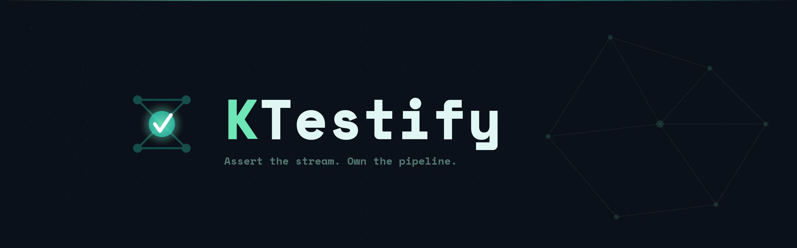
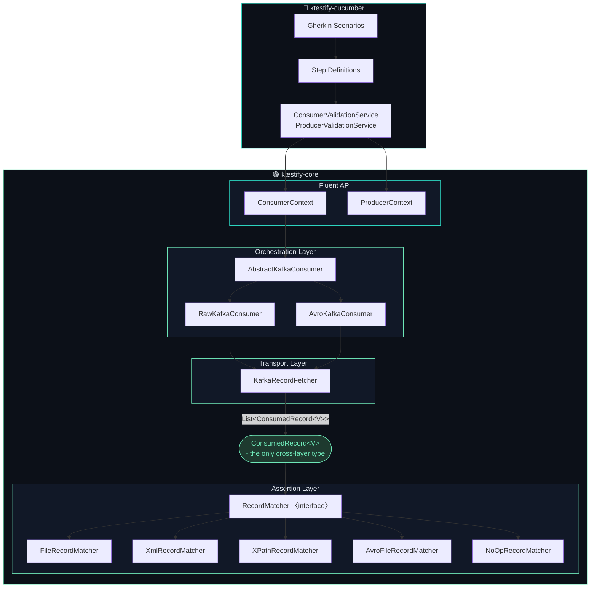

<p align="center">
  
</p>

<p align="center">
  
  
  
  
</p>

<br/>

**KTestify** is an open-source, modular framework for integration-testing
[Apache Kafka](https://kafka.apache.org/) and Kafka Streams pipelines. Its
transport-agnostic core provides message matching and a fluent Java API, while
the standalone Cucumber runner lets you describe scenarios in Gherkin. Plugins
extend those scenarios to integrations such as HTTP and Azure Blob Storage.

---

## Main Repositories

<table>
<tr>
<td width="50%" valign="top">

### 🟢 [ktestify-core](https://github.com/ktestify/ktestify-core)

The foundation library. A fluent Java API for testing Kafka producers, consumers, and Kafka Streams topologies, with no
Cucumber dependency.

**What it gives you:**

- Fluent producer & consumer DSL via `ConsumerContext` / `ProducerContext`
- Kafka Streams topology test harness
- Rich message matchers: JSON file, XML, XPath, positional fields, key-only, batch
- Avro support through Schema Registry, including `GenericRecord` matching and excluded fields
- Dynamic variable system in payloads: `{{DATE:...}}`, `{{ENV:...}}`, `{{RANDOM:...}}`
- HOCON configuration (`reference.conf` + environment variable overrides)
- Separate transport contracts for streaming (`RecordFetcher<V>`) and synchronous
  request/response (`RequestResponseClient<Req, V>`) integrations

```java
ConsumerContext<String, String> ctx = ConsumerContext.<String, String>builder()
        .topic(outputTopic)
        .matchMethod(ConfigConstants.methodMatchFile)
        .matchFilePaths(List.of("expected/order.json"))
        .readTimeout(Duration.ofSeconds(30))
        .build();

Boolean passed = new RawKafkaConsumer(ctx).call();

assertTrue(passed);
```

</td>
<td width="50%" valign="top">

### 🥒 [ktestify-cucumber](https://github.com/ktestify/ktestify-cucumber)

A **standalone BDD test runner**. Uses Cucumber 7 and Gherkin to express Kafka
scenarios in plain language, backed by the ktestify-core API. Run it with Docker
or as a fat JAR; it is not an embeddable Cucumber library.

**What it gives you:**

- Ready-to-use Gherkin steps for record production and assertions
- Raw and Avro scenarios, with key matching and positive or negative presence checks
- Raw JSON, XML, and text alongside Avro scenarios in the same suite
- Batch consumer assertions (`expectedRecordsCount`)
- `consumerReadTimeout` and `consumerDeltaTime` per-scenario tuning
- Shell script execution steps
- Rich CI reports via [cucumber-reportr](https://github.com/nil-malh/cucumber-reportr)

The runner connects to a Kafka test cluster that you provide. It does not start
a broker for you.

```gherkin
Feature: Order enrichment

Background:
Given namespace
| namespace |
| ktestify  |
Given input topic
| topicName     | topicAlias |
| raw-roundtrip | orders-in  |
Given output topic
| topicName     | topicAlias |
| raw-roundtrip | orders-out |

Scenario: Order enrichment, JSON file match
When record from file is sent
| topicName     | file              | recordKey |
| raw-roundtrip | data/order.json   | order-123 |
Then expected record from file
| topicAlias | file                    | expectedRecordKey |
| orders-out | expected/order.json     | order-123         |
```

</td>
</tr>
</table>

## Plugin Repositories

KTestify plugins use the Service Provider Interface (SPI) to add integrations
without modifying the core codebase. First-party plugins add transports and
their own Gherkin steps, and are discovered automatically by the runner.

See the [Plugin Development Guide](https://docs.ktestify.xyz/docs/extend/plugins)
to create a plugin. 

These first-party plugins are ready to use with
[ktestify-cucumber](https://github.com/ktestify/ktestify-cucumber).

<table>
<tr>
<td width="50%" valign="top">

### 🛎️ [ktestify-plugin-notifications](https://github.com/ktestify/ktestify-plugin-notifications)

Cross-platform test suite notifications for **ktestify-cucumber**. Sends a rich summary card at the end of each test
run, with per-tag group breakdowns, CI/Git context, and configurable success-rate thresholds.

**What it gives you:**

- Four built-in channels: **Teams** (Adaptive Card), **Slack** (Block Kit), generic **HTTP webhook**, and a
  zero-dependency **log** channel
- Tag-based scenario grouping, each group gets its own success rate and colour-coded style in the card
- Auto-detected CI/CD context (GitLab CI, GitHub Actions, CircleCI, Jenkins…) via `cucumber-cienvironment`
- Visual thresholds: `good` ≥ 75 %, `warning` ≥ 50 %, `attention` < 50 %
- Fully overridable templates, inline HOCON, classpath resource, filesystem path, or bundled defaults
- Extensible via SPI, custom channels registered in `META-INF/services/` are discovered automatically
- Async and failure-safe, notifications run in a background thread pool and never block a test run

```hocon
ktestify.plugins.notifications {
  enabled = true
  channels = [
    {
      type = "teams"
      enabled = true
      webhook-url = ${?KTESTIFY_TEAMS_WEBHOOK_URL}
      on-failure-only = false
    }
  ]
}
```

</td>
<td width="50%" valign="top">

### ☁️ [ktestify-plugin-azureblob](https://github.com/ktestify/ktestify-plugin-azureblob)

**Azure Blob Storage** transport support for **ktestify-cucumber**. Ready-to-use Gherkin steps for uploading and
asserting blobs are discovered automatically.

**What it gives you:**

- Gherkin step definitions for blob upload, assertion, and negative presence checks
- Seamless integration alongside Kafka steps in the same scenario
- Three auth modes, connection string, SAS token, or managed identity endpoint
- Auto-create containers on first use (configurable)
- Local development support via **Azurite** emulator with `UseDevelopmentStorage=true`
- Zero-config discovery via SPI, the plugin registers itself through `META-INF/services/`

```hocon
ktestify.plugins.azure-blob {
  connection-string = ${?AZURE_STORAGE_CONNECTION_STRING}
  request-timeout = 30s
  auto-create-containers = true
}
```

</td>
</tr>
<tr>
<td colspan="2" valign="top">

### 🌐 [ktestify-plugin-http](https://github.com/ktestify/ktestify-plugin-http)

Synchronous HTTP request/response support for **ktestify-cucumber**. Its
Gherkin steps send requests and assert response status, headers, and bodies.
The plugin uses the JDK HTTP client and is discovered automatically through
SPI.

```gherkin
Given HTTP endpoint
  | endpointAlias | baseUrl                   |
  | orders-api    | http://localhost:8080/api |
When HTTP request is sent
  | endpointAlias | method | path   | file       | responseAlias |
  | orders-api    | POST   | /orders | order.json | order-response |
Then expected HTTP response status
  | responseAlias  | statusCode |
  | order-response | 200        |
```

</td>
</tr>
</table>

---

## Architecture

KTestify enforces a strict three-layer separation so that transports, orchestration logic, and assertion strategies are
completely decoupled. `ConsumedRecord<V>` is the **only data type that crosses layer boundaries**. The diagram below shows
the Kafka record path; synchronous plugins such as HTTP use the request/response transport contract.



### Matcher catalogue

| Match strategy                   | Raw (String) | Avro (GenericRecord) |
|----------------------------------|:------------:|:--------------------:|
| JSON file comparison             |      ✅       |          ✅           |
| Key + value file comparison      |      ✅       |          ✅           |
| Positional fields (line/from/to) |      ✅       |          ✅           |
| XML structural comparison        |      ✅       |          X           |
| XPath expression matching        |      ✅       |          X           |
| Record key only                  |      ✅       |          ✅           |
| Batch (N records vs N files)     |      ✅       |          ✅           |
| No-op (presence check)           |      ✅       |          ✅           |

---

## Quick Start

### 1. Prepare a test environment

Use a dedicated Kafka test cluster, not a shared or production cluster.
Configure Schema Registry as well if your tests use Avro. See the
[CI environment guide](https://docs.ktestify.xyz/docs/getting-started/ci-environment)
for setup details.

### 2. Configure KTestify

Create an `application.conf` for the runner:

```hocon
ktestify {
  kafka.bootstrap-servers = "kafka:9092"
  kafka.topic-namespace = "my-app"
  schema-registry.url = "http://schema-registry:8081"
  framework.timeouts {
    default-read-timeout = 30s
    consumer-delta-time = 60s
  }
  framework.directories.assets = "/workspace/assets"
}
```

See the [configuration reference](https://docs.ktestify.xyz/docs/getting-started/configuration)
for defaults and environment variable names.

### 3. Run your scenarios

The recommended way to run a suite is with Docker:

```bash
docker run --rm \
  -v "$(pwd)/features:/workspace/features" \
  -v "$(pwd)/assets:/workspace/assets" \
  -v "$(pwd)/config:/workspace/config" \
  ghcr.io/ktestify/ktestify-cucumber:latest \
  --config /workspace/config/application.conf \
  /workspace/features
```

The Kafka address must be reachable from the container. The runner is also
available as a fat JAR. See the
[installation guide](https://docs.ktestify.xyz/docs/getting-started/installation)
for configuration-file, report, and tag-filtering examples.

---

## Gherkin steps at a glance

The runner includes Kafka setup, producer, and consumer steps. This example
shows valid DataTables for a raw record roundtrip:

```gherkin
Given input topic
  | topicName  | topicAlias | namespace | namespaceAlias |
  | orders-in  | orders-in  |           |                |
Given output topic
  | topicName   | topicAlias | namespace | namespaceAlias |
  | orders-out  | orders-out |           |                |
Given assets directory
  | absolutePath                  |
  | src/test/resources/assets     |

When record from file is sent
  | topicName | file        | recordKey |
  | orders-in | order.json  | order-123 |
Then expected record from file
  | topicAlias | file                  | expectedRecordKey |
  | orders-out | expected/order.json   | order-123         |
```

Other built-in Kafka validations include positional fields, XML, XPath,
Avro, batch comparisons, and positive or negative record-presence checks.
Key matching supports exact, contains, starts-with, ends-with, and regular
expression strategies. See the
[complete step reference](https://docs.ktestify.xyz/docs/write-tests/step-reference)
for all step phrases and DataTable columns.

---

## Why KTestify?

|                               | KTestify | Plain Kafka Clients | EmbeddedKafka |
|-------------------------------|:--------:|:-------------------:|:-------------:|
| Fluent assertion DSL          |    ✅     |          ❌          |       ❌       |
| BDD / Gherkin support         |    ✅     |          ❌          |       ❌       |
| Avro + Schema Registry        |    ✅     |      ⚠️ manual      |       ❌       |
| XML / XPath matchers          |    ✅     |          ❌          |       ❌       |
| Batch record assertions       |    ✅     |          ❌          |       ❌       |
| Dynamic variables in payloads |    ✅     |          ❌          |       ❌       |
| Requires a separate test broker |  ✅  |          ✅          |       ❌       |
| Transport-agnostic design     |    ✅     |          ❌          |       ❌       |
| CI-friendly                   |    ✅     |          ✅          |       ✅       |

---

## Documentation and developer resources

- [Full documentation](https://docs.ktestify.xyz/)
- [Parent POM and dependency BOM](https://github.com/ktestify/ktestify-parent)
- [Maven archetype](https://github.com/ktestify/ktestify-plugin-archetype) for
  creating plugins
- [Documentation site source](https://github.com/ktestify/ktestify-doc)

---

## Contributing

Contributions are welcome! Please read the contributing guide in each repository before opening a pull request.

1. Fork the repository
2. Create a feature branch: `git switch -c feat/my-feature`
3. Commit using [Conventional Commits](https://www.conventionalcommits.org/): `git commit -m 'feat: add my feature'`
4. Push and open a Pull Request against `main`

---

## License

KTestify is licensed under the [Apache License 2.0](https://www.apache.org/licenses/LICENSE-2.0.txt).

---

<p align="center">
  
  <br/>
  <sub>Assert the stream. Own the pipeline.</sub>
</p>
